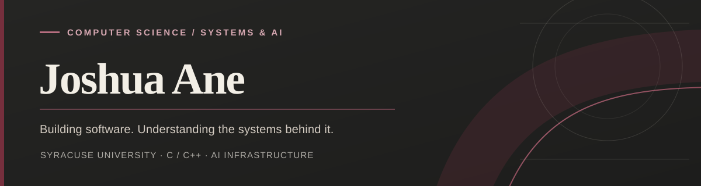

## About Me

I'm a Computer Science student at **Syracuse University**, pursuing a minor in **Artificial Intelligence Science and Engineering**.

I'm interested in software engineering, computer systems, and AI infrastructure. I'm currently strengthening my foundations in C, learning C++, and exploring operating systems, networking, and performance engineering.

## Technical Skills

**Languages:** C, Java, Python, JavaScript, TypeScript, SQL  
**Frameworks & Tools:** React, Flask, Tailwind CSS, Pandas, Git, Linux, Bash

## Featured Projects

### SkillBridge
An AI-powered career development platform that identifies skill gaps and builds personalized learning roadmaps.

### Centsibly
A budgeting application built with React, Flask, and SQLite.

### Beat the Press
A football guessing game built in Python using object-oriented programming.

## Currently Exploring

Systems Programming · C++ · Operating Systems · AI Infrastructure

## Connect

[LinkedIn](www.linkedin.com/in/joshua-ane-2049662ab)
  
